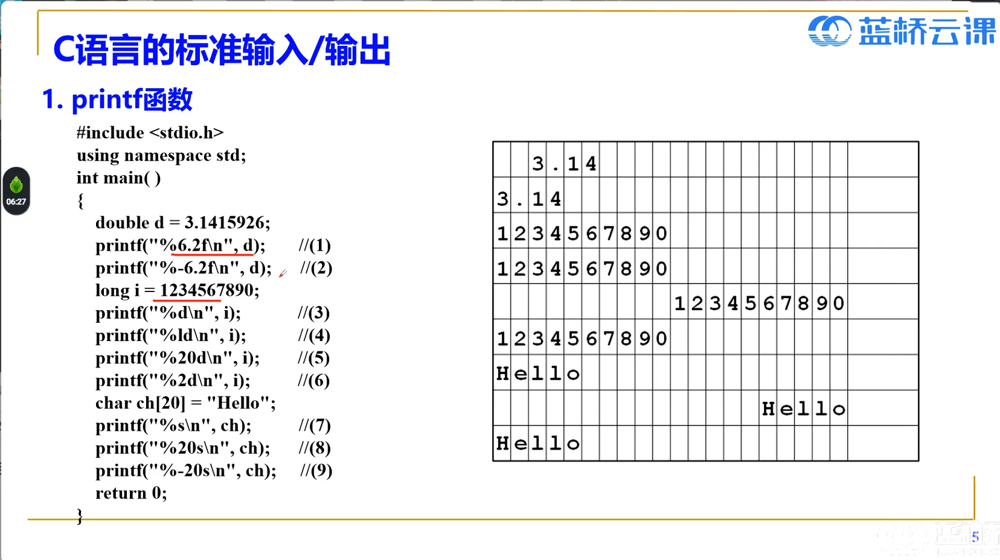
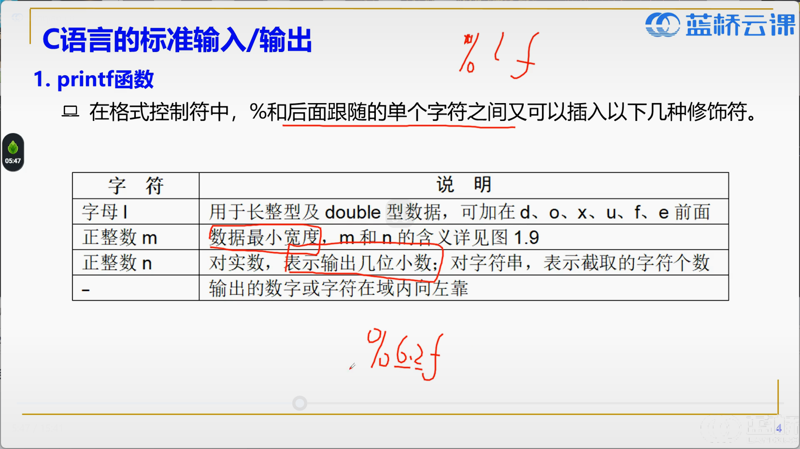

C语言的标准输入/输出
1.printf函数

 
放弃蓝桥云课
先听浙大翁恺
1.1.1
计算机如何解决问题？
计算机只会做一件事，按照你要的每一步往下做
人:what to do
计算机:how to do

   算法
计算机做的所有事情都是计算

1.1.2 计算机的思维
计算机看不懂方程，只能代数运算————枚举法
程序的执行
解释：借助一个程序，那个程序能试图理解你的程序，然后按照你的要求执行
编译：把你的程序翻译成机器语言，之后使用自己翻译过的程序，来执行程序。
语言本身没有解释与编译区分

1.2.1 为什么是C
c like 语言
语言带来的库

1.2.2简单历史
无
1.2.3编程软件
 操作系统
 嵌入式系统
 驱动系统
 底层驱动
 图形引擎、图像处理、声音效果
C语言是一种工业语言
IDE（集成开发环境）

1.3.1第一个C程序
#include < stadio.h>

int main()
{
     printf("Hello World!\n");
     
     return 0;
}
输出
"里面的内容叫做“字符串”
/n表示需要在输出的结果后面换一行

1.3.2详解第一个程序

1.3.3做点计算
int main()
{
     printf("%d",12+34); // %d说明后面有一个整数要输出在这个位置上
     
     return 0;
}

1.3.4MacOSX如何运行
无

2.1.1第二周概述

2.1.2变量定义
需要：1、有地方放输入的数字；
      2、有办法输入数字；
      3、输入的数字能参与运算。

change.c
变量
 int price = 0;
变量是一个保存数据的地方
变量的一般形式
<类型名称><变量名称>
变量的名字是一种“标识符”，意思是它是用来识别这个和那个的不同的名字。
C语言的保存字

2.1.3
变量赋值与初始化
int price = 0
赋值
“=”在计算机里是一个动作
初始化
不进行初始化在部分编译器运行会随机给出字符
变量初始化
<类型名称><变量名称>=<初始值>
多个变量在一行时，每一个变量单独赋予变量
变量类型
C是一种有类型的语言

【读整数】
scanf("%d",&price);
要求scanf这个函数读入下一个整数，读到的结果赋值给变量price 
小心price前面的&

2.1.4变量输入

2.1.5
【常量】
const是一个修饰符，加在int的前面，初始化之后就不能再修改
【try】
 plus.c
int a;
int b;
printf("请输入两个整数：");
scanf("%d %d",&a,&b);
printf("%d+%d=%d\n",a,b,a+b);

   